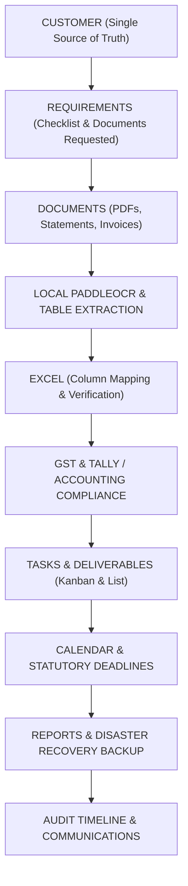

# Central Business Workflow - Enterprise Architecture

## 1. System Overview

**Central Business Workflow** is an offline-first Windows desktop operating workspace engineered for Indian SMEs, Chartered Accountants, Tax Consultants, and Corporate Finance teams. It consolidates disparate tools—accounting software (Tally), GST compliance spreadsheets, PDF files, OCR scanners, client communication, and deadlines—into one cohesive system centered around the customer.

### Core Guiding Principle
> **"What needs to be done for this customer?"**
> Every document, task, requirement, deadline, GST calculation, ledger voucher, and timeline entry connects directly back to the customer record.

---

## 2. Technology Stack

| Layer | Technology | Rationale |
|---|---|---|
| **Desktop Shell** | Tauri 2.0 (Rust) | Minimal memory footprint (<80MB), native Windows windowing, sub-millisecond IPC. |
| **Frontend Framework** | React 18 + TypeScript | Component modularity, strict compile-time type validation, zero runtime type errors. |
| **Styling & System** | Tailwind CSS + shadcn design | Professional enterprise light palette, responsive layouts, accessible typography. |
| **Local Database** | SQLite (Parameterized SQL) | Zero-maintenance, local transactional ACID guarantees, instant performance. |
| **Heavy Workers** | Python 3.12 (PaddleOCR + PyMuPDF) | CPU/GPU-isolated background processes ensuring zero UI thread blocking. |
| **Spreadsheets** | openpyxl, pandas, SheetJS | High-speed XLSX/CSV parsing, column mapping, and duplicate detection. |
| **Visualization** | Recharts | Cross-modular SVG visual analytics for turnover, task pipelines, and tax liabilities. |
| **Automated Testing** | Vitest + TypeScript | Fast unit and integration verification. |

---

## 3. High-Performance Data Relationship Model



---

## 4. Local Filesystem Layout

Conforming to Section 21 of the specification:

```
C:\ProgramData\CentralWorkflow\ (or local workspace root)
├── database/
│   └── app.db                      # Primary SQLite transactional database
├── customers/
│   ├── CUST-001/
│   │   ├── Documents/              # Invoices, bank statements, certificates
│   │   ├── Reports/                # Exported reports for this client
│   │   └── Exports/                # Converted Excel and verified OCR files
│   ├── CUST-002/
│   └── ...
├── imports/                        # Raw incoming CSV, XLSX, and DayBook XML files
├── exports/                        # Batch generated workbooks
├── temp/                           # Temporary PDF split/merge rasters
├── backups/                        # Atomic safety backups and disaster recovery zips
└── logs/                           # Background worker execution and audit logs
```

---

## 5. Security & Offline Principles

1. **100% Offline-First**: Zero mandatory external cloud dependencies.
2. **Path Traversal Protection**: All filesystem write operations validate canonical directory bounds.
3. **Audit Trails**: All customer modifications, document approvals, and task status transitions log actor, timestamp, and object ID.
4. **No Credential Scraping**: Adheres strictly to official API / local file import standards for GST and Tally.
